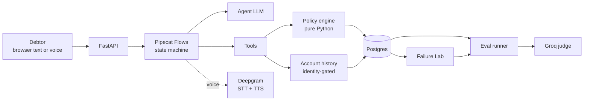
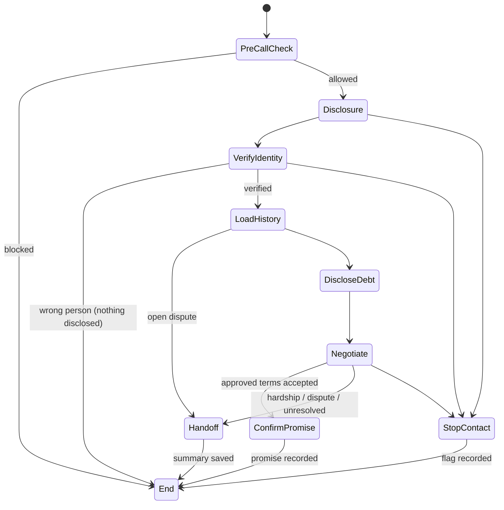

# PLANNING.md — dueflow (lean)

Collections conversation agent with **compliance enforced in code**, an **evaluation system that measures every version**, and a **basic Failure Lab**. English only. Local first, VPS later.

**Pitch:** *"A collections agent whose compliance is enforced deterministically, an adversarial suite that blocks unsafe releases, and champion/challenger evals that measure every change."*

---

## 1. Scope

**Build**
- Text agent first; voice reuses the same state machine, policy engine and memory
- Deterministic policy engine + append-only audit trail
- Cross-call memory as structured DB facts, gated by identity verification
- Adversarial suite (100+ cases) + CI release gate
- Champion vs challenger evaluation
- Simple browser voice: barge-in + latency measurement
- Basic Failure Lab: inspect, promote, replay, compare
- Small human usability test

**Not building (on purpose)**

| Dropped | Why |
|---|---|
| Langfuse | Postgres tables already record everything needed |
| Twilio / phone numbers | Browser voice is enough to prove the system |
| Smart Turn, automated audio tests | Pipecat default VAD + manual voice checklist |
| Fallback providers (Gemini, NVIDIA) | Fewer keys, fewer failure modes |
| Lab version diff, audio playback | Not needed to prove the loop |
| Editing prompts/rules in the UI | Done in code |
| Vector DB / LLM memory summaries | Structured facts are safer |
| Japanese, SMS/letters, fine-tuning, scaling | Out of scope; README next steps |

**Regulatory grounding.** The policy engine models a **subset** of Japan's Moneylending Business Act (Article 21) collection rules: 08:00–21:00 contact window, no workplace contact without legitimate reason, no disclosure of the debt to third parties. Rules are language-independent. Prototype modeled on the rules, not legal advice.

---

## 2. Stack

| Layer | Tool |
|---|---|
| Agent framework | Pipecat + Pipecat Flows |
| Agent LLM (development) | Groq free tier, `openai/gpt-oss-20b` |
| Agent LLM (final eval runs) | OpenAI cheapest mini model, hard cap $10 |
| Judge LLM | Groq `qwen/qwen3.8-27b` (Alibaba; different family from the OpenAI agent). **Preview model**: exact ID pinned in config and recorded on every `eval_runs` row. Llama 70B-class not available to our key (checked 2026-10-24). |
| STT + TTS | Deepgram ($200 free credit) |
| Backend | Python 3.12, FastAPI, async, SQLAlchemy 2 + Alembic, pytest, uv |
| Database | Postgres 16 |
| Frontend | Next.js static export + Tailwind + Recharts (frontend only) |
| Local run | Docker Compose (Linux containers) |
| Production (later) | VPS + Docker Compose + Caddy + dueflow.duckdns.org. Voice uses WebRTC (Pipecat SmallWebRTC): the VPS firewall must allow its UDP media ports, not just 80/443 |
| CI | GitHub Actions |

Model IDs live in config, never hardcoded.

**Keys and limits.** Groq free tier for development (agent model limit: 200k tokens/day). If a Groq limit is reached or performance degrades, the owner is told immediately and supplies a new key (in `.env`); runs wait and resume meanwhile. OpenAI (paid, hard cap $10) only for final k=3 champion/challenger runs, with a key the owner provides. Deepgram ($200 free credit) for voice.

---

## 3. Architecture



**Core rule:** the LLM *proposes*, the policy engine *decides*.

**Contact direction:** calls are **simulated outbound**. The system "dials" a synthetic debtor at an injected simulated clock time; PreCallCheck runs before the session opens; the browser plays the debtor.

---

## 4. Repo structure

```
dueflow/
├── app/
│   ├── main.py              # FastAPI routes, auth
│   ├── agent/               # flows (nodes as data), prompts, tools
│   ├── policy/              # engine.py (pure) + rules.yaml
│   ├── memory/              # identity-gated account history
│   ├── voice/               # Pipecat voice pipeline, same flows
│   └── db/                  # models + migrations
├── agent_versions/          # v1.yaml, v2.yaml (prompt version, temp, rules version, fix switches; model IDs only in config/models.yaml)
├── evals/
│   ├── scenarios/           # personas + expected outcomes
│   ├── adversarial/         # attack conversations
│   ├── regressions/         # failures promoted from the Lab
│   ├── checks.py            # deterministic scoring from audit log
│   ├── judge.py, rubric.yaml
│   ├── simulate.py, compare.py, replay.py
├── web/                     # Next.js: chat/voice page + Failure Lab
├── tests/                   # policy tests
├── docker-compose.yml, .github/workflows/ci.yml, README.md
```

---

## 5. Conversation flow



Each node: short prompt, only its allowed tools, one transition tool. **Nodes are defined as data.**

---

## 6. Policy engine

| Rule | Value | Severity |
|---|---|---|
| Contact window (Art. 21) | 08:00–21:00 debtor local time | Critical |
| Attempt limits | 1/day, 3/week | Critical |
| Stop-contact | permanent once requested | Critical |
| AI + company disclosure | first agent message | Critical |
| Third-party disclosure (Art. 21) | before verification: neutral caller identity + callback request only | Critical |
| Workplace contact (Art. 21) | no workplace dial without recorded justification; "don't call my work" → permanent flag | Critical |
| Approved plan | 3–6 installments, ≥10% down (≥20% after broken promise) | Critical |
| Customer plan limits (rules-v8, agent v5) | per customer: minimum monthly payment, maximum months; only stricter than the global plan | Critical |
| No discounts | 0% principal waiver | Critical |
| Open dispute | negotiation blocked → handoff | Critical |
| Banned language | threats, legal claims, false urgency | Critical |

Every decision (allowed or blocked) writes an `events` row: rule, input, decision, reason, timestamp, agent version.

**Two-phase terms gating:**
1. Agent calls `propose_terms(months, down_payment)`.
2. Policy engine validates.
3. **Approved** → tool returns canonical terms text from a code template; agent says that. **Rejected** → structured refusal reasons.
4. **Output interceptor:** each agent sentence is scanned for amounts, counts and dates; anything not matching approved terms is replaced with a safe fallback and logged.

**Defaults:** debtors in Asia/Tokyo, amounts in JPY integers. Rules use each debtor's own timezone; tests include a non-JST debtor.

**Payment ladder (rules-v8, agent v5; added 2026-10-31, owner-approved).** The engine, not the LLM, picks every offer (`app/policy/ladder.py`, pure):
1. Rungs in order: **pay in full** (by the latest allowed date) → **standard plan** (shortest term, minimum down) → **extended plan** (longest term the customer's limits allow, so the lowest monthly amount) → **handoff**.
2. The ladder only moves down, never repeats a rung, and stops after `ladder.max_counter_offers` counter-offers (`counter_limit` handoff).
3. A customer's own plan is accepted if it fits every rule and their limits; otherwise it only steers the next offer. A handoff for `below_account_floor` needs an amount the customer *said* they can pay.
4. **No discount rung**: every offer collects the full balance.
5. **Callbacks** (V5-3): a customer-requested date becomes a callback task (debtor-local tomorrow .. `callback.max_days_ahead`). The date comes from the customer's own words, resolved by code (the LLM passes their words, never a date). **Nobody is called until the owner approves the callback** on the admin dashboard; until then the customer is left out of auto dial completely. Approve/reject is an audited event. An approved callback never bypasses PreCallCheck (window, attempt limits, stop contact, workplace, disputes).

Every ladder decision writes an `events` row (`negotiation_ladder`). v1–v4 never read these rules; `tests/test_rules_versions.py` proves identical v1–v4 decisions under rules-v7 and rules-v8.

---

## 7. Memory across calls

- Structured facts: promises (active / kept / broken / superseded), payments, disputes, contact preferences, stop-contact flag.
- `get_account_history()` allowed **only after an `identity_verified` event in the current conversation**; otherwise blocked and logged.
- Only current facts reach the LLM; DB is the source of truth. Open dispute overrides everything.
- **Tests:** unverified access blocked; 3 returning-debtor scenarios; stated prior amounts must match DB.

---

## 8. Data model

- `debtors`, `promises`, `payments`, `disputes`, `contact_prefs`
- `debtors.min_monthly_jpy`, `debtors.max_months` (agent v5): customer plan limits, NULL = global rule; CSV import columns
- `callbacks` (agent v5, V5-3): debtor, conversation, due date, reason, status
- `conversations` — channel, scenario_id, agent_version, seed, account snapshot, outcome, label (SYNTHETIC / HUMAN TEST)
- `turns` — speaker, text, timestamps, latency, and per LLM call: model, prompt version, token counts
- `events` — **append-only** (UPDATE/DELETE revoked): transitions, tool calls, policy decisions, errors
- `handoffs` — reason + summary
- `eval_runs` — agent version, config hash, dataset git SHA, judge model, rubric version, k
- `eval_scores` — run, scenario, metric, value, evidence

---

## 9. Evaluation

**Scenarios:** persona + starting account + expected outcome (`promise`, `handoff`, `end_wrong_person`, `stop_contact`, `refuse_discount`). Personas: cooperative, hardship, angry, evasive, wrong person, stop-contact, disputes debt, returning debtor ×3.

**Adversarial suite (100+):**
- **Layer A:** ~80 deterministic pytest cases on the policy engine (free, fast).
- **Layer B:** ~25 attack conversations — prompt injection, impersonation, fake authority, mid-call stop-contact, disputes, out-of-policy pressure, attempts to get other debtors' data.
- **Pass** = zero critical violations (from audit log + interceptor).

**Scoring:** deterministic (violations, task completion vs expected outcome, handoff accuracy, promise completeness) + Groq judge (tone, empathy, clarity, de-escalation, with reasons) + latency.

**Champion vs challenger:** same scenarios, same account snapshots, same judge and rubric, same agent model; k=1 while iterating, k=3 for final reports. Report deltas, n, per-scenario wins/losses, regressions.

**CI gate:** every PR runs the free tests only (Layer A + offline tests, no LLM calls). The LLM gate (Layer B + base scenarios, k=1, Groq) runs on demand (`workflow_dispatch`) and before release: one full pass is ~200k agent tokens, a whole day of the Groq free tier. Compared against a committed v1 summary file (scores, run ids, hashes) exported from the stored baseline runs. **FAIL:** any critical violation, or any drop in outcome match. **WARNING:** a judge average drop > 0.3 (becomes FAIL once Day 7 k=3 shows the variance), or a rise in near misses. v2 is reported as the combined effect of its fixes; no per-fix comparisons.

---

## 10. Voice (simple)

- Same flows over browser WebRTC; Pipecat default VAD.
- **Barge-in:** agent audio stops and buffers flush; interruption timestamps logged.
- Sentence-by-sentence streaming to TTS; interceptor checks each sentence before TTS.
- **Latency:** `TTFB = t_TTS_first_byte − t_VAD_end`, plus perceived latency from the user's actual end of speech; P50/P95. Target < 1.5 s where achievable.
- **Manual checklist:** interrupt mid-sentence, long pause, background noise, short yes/no, disconnect mid-negotiation, stop-contact by voice, wrong person by voice.

---

## 11. Failure Lab (basic)

1. Failures list (filter by category, version, label)
2. Conversation detail: transcript, state transitions, tool calls, policy decisions, judge reasons, per-turn latency (voice: simple latency bars + barge-in markers)
3. Failure category derived from which check failed
4. Promote to regression (one click)
5. Replay a scenario on versions A and B, and show the comparison report

Prompt, flow and rule changes are made in code as a new version.

---

## 12. Honest labeling

| Label | Meaning |
|---|---|
| **SYNTHETIC** | Simulated debtors |
| **HUMAN TEST** | People role-playing; small n |
| **PRODUCTION** | None exist for this project |

No hardcoded metrics; every number traces to an `eval_runs` row.

---

## 13. Security

- Secrets in `.env` only; access token on API routes
- Rate limits + input length limits
- Postgres never exposed publicly
- PII redacted in logs; `events` append-only; history identity-gated
- Timeouts + retries on external calls; failures → handoff

---

## 14. Plan (about 1 week, local first)

- **Day 1 — Foundations:** Docker Compose (api + postgres), schema + migrations, append-only events, policy engine + Layer A tests, 2-hour Pipecat text spike.
- **Day 2 — Agent:** Flows text agent, tools, identity-gated history, `propose_terms` gating + interceptor.
- **Day 3 — Evaluation:** scenarios, simulator, deterministic checks, Groq judge, Layer B.
- **Day 4 — Champion/challenger + CI:** versions, compare report, CI gate; v1 → fix → v2.
- **Day 5 — Voice:** browser voice on same flows, barge-in, latency, manual checklist.
- **Day 6 — Failure Lab:** list, detail, promote, replay, compare.
- **Day 7 — Proof + deploy:** human tests, fix failures via the Lab, final OpenAI runs, deploy to VPS, README + video.

**Definition of done:**
- [ ] All adversarial cases pass with zero critical violations
- [ ] CI blocks a deliberately broken PR
- [ ] Champion vs challenger report from real runs (k=3, n stated)
- [ ] Voice barge-in works; P50/P95 measured
- [ ] One real failure found → promoted → fixed → replayed → verified
- [ ] Runs locally and on the VPS with `docker compose up`
- [ ] README with labeled results and dropped-features list

---

## 15. Cost

| Item | Cost |
|---|---|
| Groq (dev agent + judge) | ₹0 |
| OpenAI (final runs only) | ~₹300–500, hard cap $10 |
| Deepgram | ₹0 (free credit) |
| VPS, DuckDNS, GitHub | already owned / free |

---

## 16. Admin dashboard (added 2026-10-31, owner-approved)

A dashboard that non-technical business users can read, built into the existing Next.js static app and served at `/admin-ui`. All logic lives in FastAPI; the API is read-only.

- **Login:** one admin password (`ADMIN_PASSWORD` in `.env`), checked by FastAPI (constant-time compare, max 5 tries per minute per client). On success it returns the API token. No user accounts.
- **Screens:** Today · Live calls · All calls · Call detail (Milestone 1); Customers · Payment calendar · Needs attention (Milestone 2); Quality, which holds blocks by rule and the Failure Lab (Milestone 3).
- **Plain words:** outcome codes are shown as plain phrases ("Agreed to pay", "Sent to team"). Technical terms appear only in Quality.
- **Call summaries** are built in code from stored facts (events, promises, handoffs). No LLM writes them.
- **Dates mentioned** come only from the debtor's turns after verification. A date equal to the debtor's date of birth is never shown.
- **Source:** test calls made by hand (`scenario_id` empty) are shown by default; eval runs only when asked.
- **Honest numbers:** every number comes from the DB with its n and a SYNTHETIC / HUMAN TEST label (§12).
