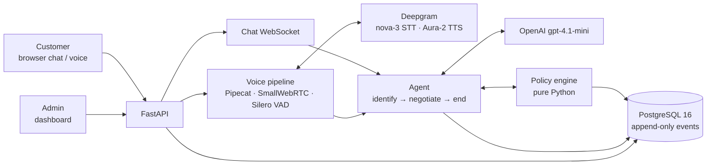

# dueflow

An AI collections agent for **chat and voice** where compliance is enforced in code, not by the AI.

dueflow calls a customer about an overdue balance, confirms who they are and agrees a payment plan,
by chat or by live browser voice. An LLM writes the words. A deterministic policy engine in plain
Python decides every offer, every disclosure and every contact, and records each decision in an
append-only audit log. An admin dashboard shows every call, transcript, promise and block.

> **Core rule:** the LLM proposes, the policy engine decides.

All results in this repository are **HUMAN TEST** or **SYNTHETIC** (simulated) runs with test
customer accounts. None are production outcomes.

---

## Contents

- [How it works](#how-it-works)
- [Architecture](#architecture)
- [Tech stack](#tech-stack)
- [Main features](#main-features)
- [Built for real-world calls](#built-for-real-world-calls)
- [Project structure](#project-structure)
- [Setup (local)](#setup-local)
- [Using it](#using-it)
- [Voice on a server](#voice-on-a-server)
- [Testing and evaluation](#testing-and-evaluation)
- [Configuration](#configuration)
- [Security](#security)
- [Results](#results)
- [Roadmap](#roadmap)

---

## How it works

Every call follows the same flow, in chat and in voice:

```
Pre-call check → AI + company disclosure → Verify identity → State balance
      → Engine picks offers → Promise or handoff → "Anything else?" → Close
```

Offers move down a fixed ladder chosen by the engine, never by the LLM:
**pay in full → standard plan → extended plan → a colleague from the team.**

| Channel | How |
|---|---|
| **Chat** | Browser page → FastAPI WebSocket → agent → every reply checked sentence by sentence → customer |
| **Voice** | Browser mic → WebRTC (Pipecat SmallWebRTC) → Silero voice detection → Deepgram nova-3 speech-to-text → the same agent → checked sentence → Deepgram Aura-2 text-to-speech → browser |
| **Admin** | One admin password → Today, Live calls, All calls, Call detail, Customers, Payment calendar, Needs attention, Quality, Failure Lab (read-only) |

## Architecture



| Layer | What it does |
|---|---|
| **Client** | Chat page, voice page and the admin dashboard, all served by the same FastAPI app |
| **API** | Bearer-token routes, admin login with a rate limit, chat over WebSocket, voice over WebRTC |
| **Voice gateway** | Voice detection, speech-to-text, the agent, text-to-speech, barge-in, per-turn latency |
| **Agent** | A state machine defined as data: each step has a short prompt and only its allowed tools. Openings, identity retries, terms, handoffs and goodbyes are scripted word for word |
| **Policy engine** | Pure Python, no LLM, no network, no DB writes inside rules. Contact rules, identity, plan terms, the payment ladder and the output guard |
| **Data** | PostgreSQL. Every policy decision (allowed **and** blocked) is an `events` row with rule, input, decision and reason. `events` can never be updated or deleted |

## Tech stack

| Layer | Tool |
|---|---|
| Agent LLM | OpenAI `gpt-4.1-mini` |
| Speech-to-text | Deepgram `nova-3` |
| Text-to-speech | Deepgram Aura-2 `aura-2-thalia-en` |
| Voice pipeline | Pipecat 1.14, SmallWebRTC, Silero VAD |
| Eval judge / simulator | Groq `qwen/qwen3.8-27b` (judge), `openai/gpt-oss-120b` (simulated customer) |
| Backend | Python 3.12, FastAPI, SQLAlchemy 2 (async), Alembic, asyncpg, Pydantic |
| Database | PostgreSQL 16 |
| Admin UI | Next.js (static export), Tailwind, Recharts |
| Tooling | uv, pytest, ruff, mypy, Docker Compose |

Model IDs live only in [`config/models.yaml`](config/models.yaml), never in code or `.env`.

## Main features

| Feature | How it works |
|---|---|
| **The engine picks every offer** | The LLM calls `next_offer`; the engine returns the next allowed rung with its exact terms, including the total. A customer's own limit ("I can pay 10,000 a month") skips offers above it |
| **Identity before disclosure** | No balance, amount or date is said until name and date of birth match. Spoken dates ("January first, two thousand five") are read by code |
| **Output guard** | Every sentence is scanned before it is sent or spoken. Amounts, counts and dates that don't match approved terms, threats, legal claims and false urgency are blocked and logged |
| **Full terms before a promise** | A promise is recorded only after every approved amount, count and date was said and the customer agreed |
| **Scripted, explained endings** | Handoffs say why and what happens next; one "anything else?"; a question about the agreed plan gets a code-built readback |
| **Append-only audit trail** | Allowed and blocked decisions alike; the dashboard and every result are read from it |
| **Cross-call memory** | Promises, payments, disputes and contact preferences are structured DB facts, readable only after identity is verified |
| **Versioned agents** | `agent_versions/v1..v5.yaml` (prompt version, temperature, rules version, fix switches) for champion/challenger evals |

## Built for real-world calls

| Real-world problem | How dueflow handles it |
|---|---|
| Customer pauses mid-sentence | Voice detection plus a 0.6 s silence wait; a date split across a pause is joined |
| Names speech-to-text mishears | The customer's name is sent to Deepgram as a hint on each call |
| Customer talks over the agent | Barge-in stops the agent's audio and keeps only what was heard in its memory |
| Silence at the end of a call | After "anything else?" the agent waits about 10 s before a polite close |
| Customer shares hardship | One short empathy phrase, never repeated and never used as pressure |
| Calling at the wrong time / too often | 08:00–21:00 in the customer's own timezone; at most 1 call a day, 3 a week |
| Someone else answers | Neutral caller identity and a callback request only; nothing about the debt |
| "Stop calling me" / "Don't call my work" | Permanent flag; no further calls to that customer or number |
| Customer disputes the debt | Negotiation blocked; handed to the team |
| Broken earlier promise | Down payment rises from 10% to 20% |
| Discount requests | Never: every plan collects the full balance |

The rules model a subset of Japan's Moneylending Business Act (Article 21) collection rules. They
are a prototype modelled on the rules, not legal advice.

## Project structure

```
dueflow/
├── app/
│   ├── main.py               # FastAPI app, routes, static pages (/dev, /admin-ui)
│   ├── config.py             # settings from environment (.env)
│   ├── models_config.py      # loads config/models.yaml
│   ├── clock.py              # injectable clock (policy code never reads system time)
│   ├── calls.py              # simulated outbound dial + pre-call check
│   ├── admin*.py             # admin dashboard queries (overview, customers, quality)
│   ├── agent/                # agent: nodes (as data), tools, scripts, session, negotiation
│   ├── api/                  # HTTP/WebSocket routes: auth, calls, chat, voice, admin, lab
│   ├── policy/               # pure policy engine + rules.yaml (contact, identity, ladder, output check)
│   ├── voice/                # Pipecat voice pipeline, latency report
│   ├── llm/                  # LLM client (timeouts, retries, rate-limit handling)
│   └── db/                   # SQLAlchemy models, Alembic migrations, seed data, audit
├── agent_versions/           # v1.yaml … v5.yaml: versioned agent settings
├── config/models.yaml        # model IDs (committed); secrets stay in .env
├── evals/
│   ├── scenarios/            # personas + starting accounts + expected outcomes
│   ├── adversarial/          # scripted and adaptive attack conversations
│   ├── regressions/          # failures promoted from the Failure Lab
│   ├── checks.py             # deterministic scoring from the audit log
│   ├── judge.py, rubric.yaml # LLM judge (tone, empathy, clarity, de-escalation)
│   ├── simulate.py, run.py   # simulated customer + eval runner
│   ├── compare.py, gate.py   # champion vs challenger report, release gate
│   └── replay.py, lab.py     # Failure Lab replay
├── tests/                    # offline test suite (policy, agent, voice, admin, evals)
├── web/
│   ├── app/                  # Next.js admin dashboard (static export → web/out)
│   └── dev/                  # dev pages: chat (index.html), voice (voice.html)
├── docs/                     # voice notes, defects, eval reports
├── reports/                  # generated eval / compare / gate reports
├── docker-compose.yml        # local: api + postgres (+ web build tool)
├── docker-compose.vps.yml    # server: api (host network) + postgres on localhost only
├── Dockerfile, Makefile, pyproject.toml, uv.lock, alembic.ini
├── .env.example              # every setting, no secrets
└── PLANNING.md               # full design (source of truth)
```

## Setup (local)

**Requirements:** Docker Desktop (or Docker Engine + Compose v2). Python and Node are not needed on
the host; everything runs in containers.

```bash
# 1. Settings: copy the example and fill in your own values
cp .env.example .env
#    Set POSTGRES_PASSWORD, APP_DB_PASSWORD, API_TOKEN, ADMIN_PASSWORD,
#    OPENAI_API_KEY (agent), DEEPGRAM_API_KEY (voice), GROQ_API_KEY (evals).

# 2. Start the API and Postgres
docker compose up -d

# 3. Create the schema (incl. the restricted app role) and add test customers
docker compose exec api alembic upgrade head
docker compose exec api python -m app.db.seed

# 4. Build the admin dashboard (only when the UI changes)
docker compose run --rm web

# 5. Check it is up
curl http://127.0.0.1:8000/health      # {"status":"ok","db":"ok"}
```

The API listens on `127.0.0.1:8000` only. Postgres has no published port locally.

Makefile shortcuts: `make up`, `make migrate`, `make seed`, `make test`, `make lint`,
`make reset-dev` (wipes the local database).

## Using it

| Page | URL | Notes |
|---|---|---|
| Chat | `http://127.0.0.1:8000/dev/` | Enter the `API_TOKEN`, pick a customer and agent version (`v5`) |
| Voice | `http://127.0.0.1:8000/dev/voice.html` | Needs a server with WebRTC UDP access (see below); allow the microphone |
| Admin dashboard | `http://127.0.0.1:8000/admin-ui/` | Log in with `ADMIN_PASSWORD` |

Test customers (`D-001` … `D-014`) come from `app/db/seed.py`. Calls are **simulated outbound**:
the system "dials" a test customer at a simulated time, and the pre-call check decides first.

## Voice on a server

WebRTC audio does not reach a Docker Desktop container, so live voice runs on a Linux server with a
public IP. [`docker-compose.vps.yml`](docker-compose.vps.yml) runs the API with host networking
(listening on `127.0.0.1` only) and Postgres published on `127.0.0.1:55432` only.

```bash
# On the server, in the project folder, with secrets in .env.spike (never committed)
docker compose -p dueflow --env-file .env.spike -f docker-compose.vps.yml up -d --build
docker compose -p dueflow --env-file .env.spike -f docker-compose.vps.yml exec api alembic upgrade head
docker compose -p dueflow --env-file .env.spike -f docker-compose.vps.yml exec api python -m app.db.seed

# Allow WebRTC media only from your own IP
sudo ufw allow from <your-ip> proto udp to any port 32768:60999

# From your computer: reach the API through an SSH tunnel
ssh -N -L 18000:127.0.0.1:8000 <user>@<server>
# then open http://localhost:18000/dev/voice.html
```

Shut down: `sudo ufw delete allow from <your-ip> proto udp to any port 32768:60999`, then
`docker compose -p dueflow --env-file .env.spike -f docker-compose.vps.yml down`, then close the tunnel.

Voice latency report: `docker compose … exec api python -m app.voice.latency --site vps`.
More detail in [`docs/voice.md`](docs/voice.md).

## Testing and evaluation

```bash
docker compose exec api pytest                                   # offline suite, no LLM calls
docker compose exec api ruff check . && docker compose exec api mypy app evals tests
make eval SUITES="base adversarial" K=1 AGENT_VERSION=v5         # live eval (spends LLM tokens)
```

| Layer | What it checks |
|---|---|
| **Offline tests** (~890) | Policy rules (every change has allowed **and** blocked cases), agent flow, output guard, voice pipeline, admin queries, append-only events |
| **Adversarial suite** | Prompt injection, impersonation, fake authority, mid-call stop-contact, disputes, out-of-policy pressure, attempts to get other customers' data |
| **Scenarios** | Cooperative, hardship, angry, evasive, wrong person, stop-contact, dispute, returning customers |
| **Scoring** | Deterministic checks from the audit log + Groq judge (tone, empathy, clarity, de-escalation) + latency |
| **Champion vs challenger** | Same scenarios, accounts, judge and rubric; k=1 while iterating, k=3 for final reports |
| **Failure Lab** | Inspect a failure → promote to regression → replay on versions A and B → compare |

Pass = zero critical violations. Every displayed number comes from a stored `eval_runs` row.

## Configuration

| File | Holds |
|---|---|
| `.env` (never committed) | Secrets: database passwords, `API_TOKEN`, `ADMIN_PASSWORD`, `OPENAI_API_KEY`, `DEEPGRAM_API_KEY`, `GROQ_API_KEY` |
| `.env.example` | Every setting with placeholder values |
| `config/models.yaml` | Agent, judge, simulator, STT and TTS model IDs |
| `app/policy/rules.yaml` | Contact window, attempt limits, plan terms, ladder, banned phrases, identity limits |
| `agent_versions/*.yaml` | Prompt version, temperature, rules version and fix switches per agent version |

## Security

- Secrets only in `.env` / `.env.spike`; both are git-ignored.
- API and Postgres listen on localhost only; Postgres is never exposed publicly.
- The API runs as a restricted database role with no UPDATE or DELETE on `events`; a trigger
  rejects UPDATE/DELETE/TRUNCATE on `events` for every role.
- Account history is identity-gated; access before verification is blocked and logged.
- Logs keep IDs, counts and timings, never what the customer said.
- Admin login: one password, constant-time compare, 5 tries per minute.

## Results

Hand-made **HUMAN TEST** calls on the server (2026-11-03), agent `v5` (prompts v5.4 – v5.12), test
customer accounts. All numbers are read from the database.

| Measure | Value |
|---|---|
| Conversations | 10 (6 voice, 4 chat) |
| Outcomes | 2 promises (¥140,000, full balance), 3 explained handoffs, 2 failed identity, 3 disconnected |
| Verified calls reaching an outcome | 5 of 5 |
| Policy decisions | 232 events: 197 allowed, 12 blocked |
| Voice latency, perceived (n = 26 agent turns) | P50 1,991 ms · P95 4,018 ms (scripted lines P50 1,013 ms) |

Earlier eval reports (SYNTHETIC, agents v1–v3) are in [`reports/`](reports/) and [`docs/`](docs/).

## Roadmap

- Bring LLM voice replies to the 1.5 s target (one LLM round trip per offer).
- Verify barge-in in a live call (built and tested offline).
- Run the full adversarial and scenario evals on agent v5, then a k=3 champion/challenger report.
- A wider human test, and a production deployment behind HTTPS.

Not built on purpose: phone numbers (Twilio), Langfuse, extra fallback providers, vector memory,
editing prompts in the UI. See `PLANNING.md` §1.
